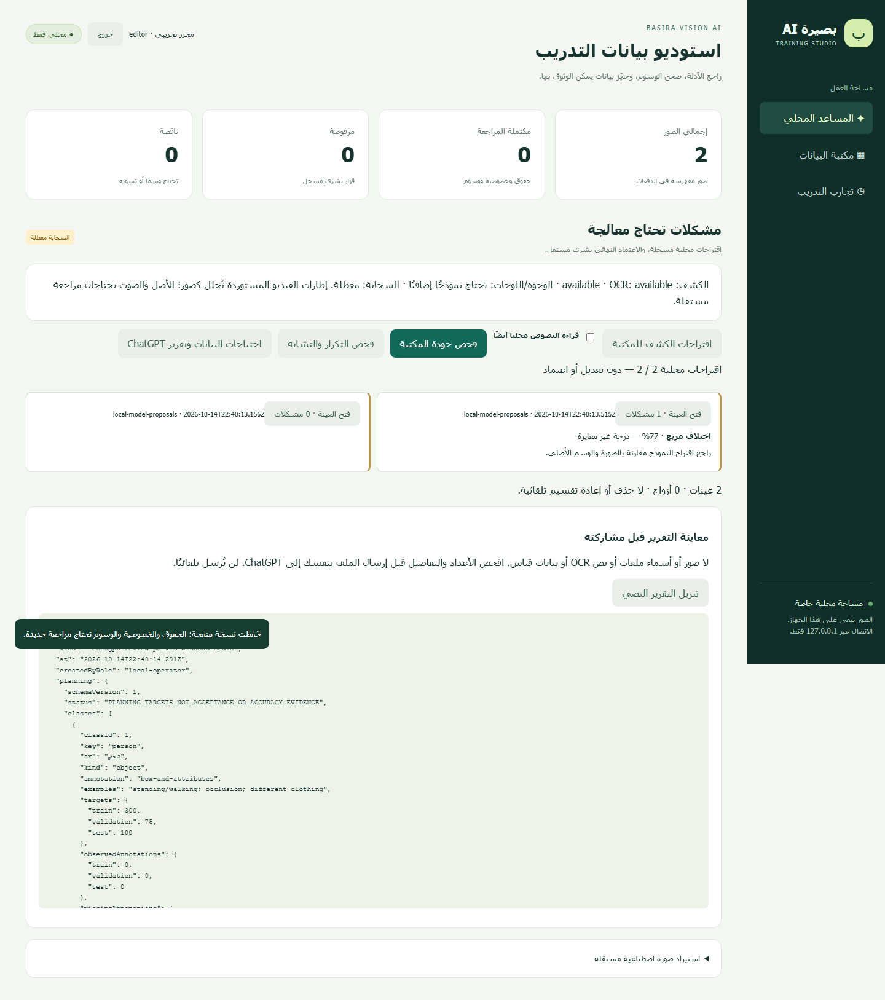
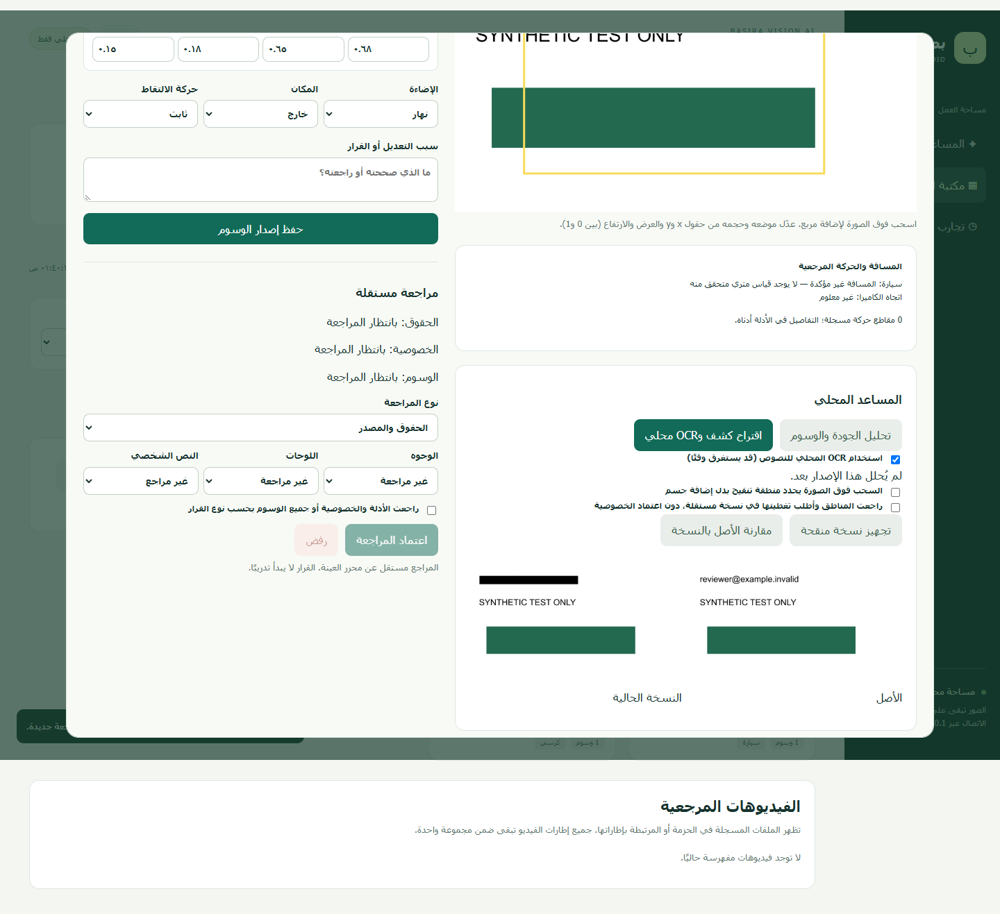

# تقرير Basira AI Training Studio — المساعد المحلي

المرجع: رأس Draft PR #39، الالتزام `bd5b0b7f482884eed70c06d7119037641e01fa24`، والفرع المستقل `codex/basira-studio-local-assistant`. لم تتغير محركات الإنتاج، ولم يبدأ تدريب أو دمج أو نشر. التشغيل والخطوات في [STUDIO-ASSISTANT.md](../ml/vision/STUDIO-ASSISTANT.md).

## ما يعمل فعليًا

| القدرة | الحالة المثبتة وحدودها |
|---|---|
| الجودة والخصوصية الأولية | تقارير محلية مربوطة بـSHA والإصدار عن الدقة والإضاءة والتفاصيل والبيانات الوصفية ونقص مراجعة الوسوم؛ قواعد تقريبية |
| الكشف والتوسيم المساعد | إعادة استخدام EfficientDet Lite0 وموفره القائم داخل المتصفح، فرديًا أو جماعيًا؛ اقتراح تصنيف/حدود/أجسام غير موسومة، ينقلها المحرر اختياريًا ويحفظ إصدارًا |
| OCR | تشغيل Tesseract القائم دون خدمة خارجية؛ اكتشف بريدًا اصطناعيًا واقترح منطقة تنقيح، دون حفظ النص الخام في التقرير |
| التنقيح | تغطية مناطق يختارها الإنسان في PNG مستقلة، مقارنة قبل/بعد، سجل المناطق والبصمات والفاعل والوقت، دون تعديل الأصل أو اعتماد الخصوصية |
| التكرار والتشابه | بصمات بايتات/بكسلات وdHash وتوزيع سطوع؛ فحص الأصل والمنقح، مراجعة مستقلة للمرشحين، حجب تصدير Studio عند التسرب أو التشابه غير المحسوم |
| الصور الاصطناعية | استقبال محلي بإثبات المصدر والأداة والنموذج والإعدادات والحقوق، فصل وفلاتر، pending، دون تقييم حقيقي/معايرة/تدريب تلقائي |
| التعاون مع ChatGPT | حزمة احتياجات 35 فئة ومعاينة وتنزيل يدوي بلا صور أو نص OCR أو هوية أشخاص؛ لا إرسال تلقائي أو قبول اعتماد آلي |
| الاعتماد البشري | الحفاظ على البوابات القائمة، ومنع المساهمين السابقين ورافع الصورة الاصطناعية من اعتمادها بعد تحرير شخص آخر |

تم إصلاح احتمال رجوع فهرس قديم إذا تزامنت قراءته مع حفظ إصدار؛ اختبار متحكم فيه يحاكي هذا السباق ويثبت ظهور الإصدار الجديد.

## الاختبارات والأدلة

اجتازت **78 حالة Node**: 43 للأدوات السابقة، 20 للاستوديو، 15 للمساعد. تغطي حقوقًا مرفوضة باقية بعد التحرير، منع إعادة تسمية أصل مرفوض، استقلال كل المساهمين، حفظ الأصل، SHA/إصدار التحليل، تقارير OCR دون نص حساس، التشابه وإعادة الضغط والجلسات، حجب التقسيم المجمد، حجب الفهرسة الجزئية، والاصطناعي غير المؤهل. الحالات والموافقات داخل الاختبارات اصطناعية بالكامل.

اجتاز TypeScript والبناء. تحذيرات أحجام حزم Vite الموجودة لا تتعلق بتدريب أو نشر. اختبارات المتصفح موثقة في [browser-validation.json](vision-ai-evidence/studio-assistant/browser-validation.json): تشغيل فعلي للكشف وOCR، كشف النص الاصطناعي، التنقيح، الكشف الجماعي، حزمة ChatGPT، الاستيراد الاصطناعي والتحديث التلقائي، رفض CSRF، عدم وجود مسار سحابي، صفر طلب خارجي وصفر خطأ صفحة، وaxe دون مخالفات على قسم المساعد بعرض 390px. أزمنة التحديث الدقيقة مسجلة في JSON وليست وعدًا لأجهزة أخرى.

صورة النص الاصطناعية لم تنتج اقتراحات أجسام (0)؛ نجاح تنفيذ الكشف يثبت عمل المسار فقط. اختبارات المقارنة تستخدم مخرجات نموذج اصطناعية لاختبار التصنيف والمربعات والأجسام غير الموسومة، ولا تثبت دقة النموذج على صور حقيقية. لم يُشغّل التحليل على الدفعة الحقيقية، ولم تُمنح أي موافقات بيانات حقيقية.

أعيد اختبار وظائف PR #39: عرض 12 صورة، تحرير إصدار، حجب الاعتماد الذاتي، الاستيراد القائم والتحديث إلى 13، فيديو اصطناعي قابل للتشغيل، الهاتف وaxe. الأدلة التجريبية القديمة محفوظة؛ أدلة إعادة الاختبار الخاصة لا ترفع مع صور بيانات.

فحص النشر لم يجد أسرارًا أو ملفات بيانات خاصة في التغييرات الصادرة؛ استثنى فقط لقطتي واجهة اصطناعيتين بأسماء ثابتة وبصمات موثقة. تحقق قرائي مستقل من بصمات ملفات دفعة Open Images الخاصة الـ211 وأثبت أنها بقيت دون تغيير. هذا فحص أنماط وبصمات، ولا يغني عن مراجعة محتوى الملفات بشريًا.

## ما يحتاج مراجعة ChatGPT أو تجهيزًا إضافيًا

- ترتيب احتياجات البيانات والظروف والسلبيات الصعبة في الحزمة النصية. أهداف العينات تخطيطية؛ الأعداد الاصطناعية ليست دليل دقة.
- معايرة حدود الجودة والتشابه على صور حقيقية مع قرارات بشرية مستقلة؛ الحماية الحالية تفشل مغلقة عند أكثر من 1000 عينة أو خطأ فهرسة، وقد تنتج مرشحين زائفين وتفوت تحويرات كبيرة.
- نموذج محلي مرخص لتحديد الوجوه ولوحات السيارات، ثم تقييم recall مستقل. المناطق اليدوية وOCR لا يثبتان خلو الصورة من جميع البيانات الشخصية.
- تخصيص كشف العوائق الأرضية بعد جمع بيانات حقيقية معتمدة. النموذج الحالي لم يتعلم تخصص بصيرة في هذه المهمة.
- تجهيز تتبع وتحليل فيديو/صوت مستقل؛ المتاح الآن تحليل الإطارات المستخرجة ومراجعة الفيديو الأصلية القائمة. قياسات المسافة المحفوظة لا تتغير ولا يستنتج المساعد أمتارًا.
- خدمة توليد اختيارية أو تحليل سحابي مستقبلي غير مجهزين. الاستقبال اليدوي يعمل؛ لا مفاتيح أو رفع خارجي أو توليد تلقائي.
- قبل التدريب: بيانات حقيقية معنونة ومعتمدة، مراجعات مستقلة للحقوق والخصوصية والوسوم والتشابه، جلسات اختبار منفصلة، لقطة Studio المدققة، ثم البوابات والتجميد والقياسات القائمة. لا استبدال للنموذج قبل نتائج مستقلة.

المراجعة البشرية النهائية لازمة لكل أصل ونسخة؛ تقارير المساعد ومخرجات ChatGPT لا تمنح اعتمادًا. رفض الحقوق يوجه إلى مصدر مستقل أو مثال اصطناعي جديد، ولا يعالج بتغيير الصورة المرفوضة.
