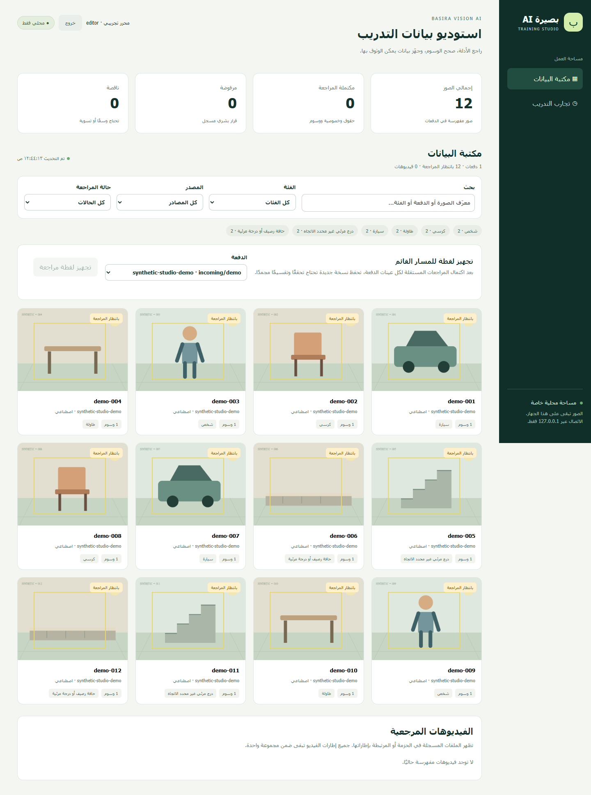
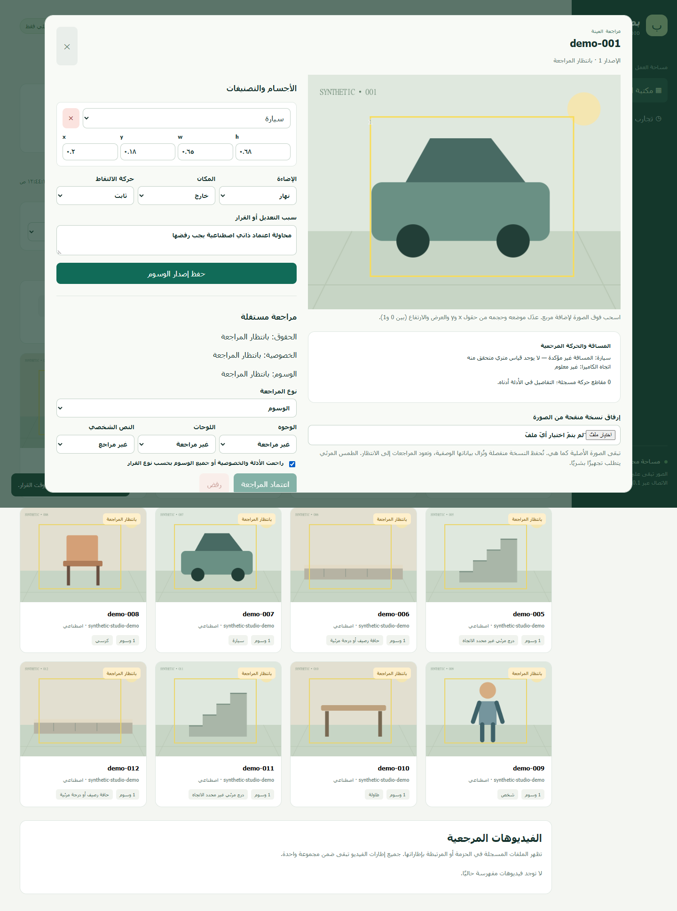
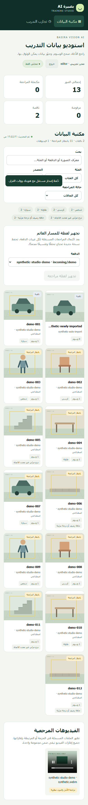
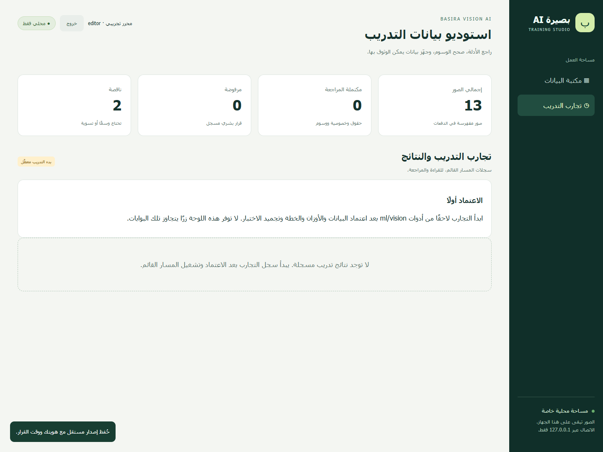

# Basira AI Training Studio — تقرير المراجعة

تاريخ المراجعة: 2026-10-15 بتوقيت الرياض. الأساس رأس Draft PR #38، `947d7da31d8477c2b6b148d7091c3763542bf89c`، والفرع المستقل `codex/basira-training-studio`. لا تعديلات لمحركات الإنتاج أو النموذج أو مسار النشر.

## المنجز

- لوحة RTL متجاوبة مع مكتبة الصور والإطارات والفيديوهات، صناديق الكشف والوسوم، مؤشرات الحالات وأعداد العينات حسب الفئة والبحث والتصفية.
- قراءة ديناميكية لفهارس Basira-Vision-Datasets وإظهار الدفعات الجديدة دون توليد REVIEW.html. الأصول والملف السابق محفوظان.
- حسابات محلية بأدوار، scrypt، جلسات وCSRF، وقرارات مرتبطة بهوية المستخدم المصادق عليه ووقت الخادم والسبب. مراجعة مستقلة، وسحب الاعتمادات عند التحرير أو الرفض.
- تصحيح الفئات والصناديق وظروف الالتقاط، حفظ إصدارات منفصلة وسلسلة parent SHA، رفض تعارض المدخلات والإصدارات، وإرفاق نسخ منقحة مستقلة مع إزالة metadata.
- قراءة أدلة الحقوق محليًا كنص مع فحص SHA، عرض قياسات مستوفاة للعقد فقط مع ضرورة اعتماد الدليل، ومقاطع حركة مرتبطة بالعينة. لا تقدير أمتار من البكسلات.
- تجهيز لقطة مراجعة تستخدم validateDataset القائم، وتحفظ تقسيمًا سابقًا مجمدًا أو تتطلب تقسيمًا جديدًا للدفعات غير المقسمة. ملفات المصادر لا تتغير.
- قراءة نتائج التجارب مستقبلًا، مع تعطيل بدء التدريب. لم يُجهز GPU أو يبدأ تدريب أو يثبت تحسن دقة.

## أدلة التحقق

نتائج الاختبارات التفصيلية والصور الاصطناعية في [browser-validation.json](vision-ai-evidence/studio/browser-validation.json). اكتمل اختبار استيراد فعلي عبر importBundle بوسائط وصلاحيات **وهمية للاختبار فقط**، وظهر عدد العينات من 12 إلى 13 في واجهة مفتوحة دون إعادة إنشاء HTML. observedMs في التقرير هو زمن الملاحظة لهذه التجربة وليس ضمان أداء على مجلدات ضخمة.

اختُبرت الصناديق والفلاتر والتحرير والمراجعة، فك الصور وتشغيل فيديو WebM اصطناعي، العرض على 390px وفحص axe، وعدم وجود طلبات خارجية أو أخطاء JavaScript. حالات الخادم تشمل الحماية من Host/Origin/CSRF، المصادقة والأدوار والاعتماد الذاتي، metadata، SHA وRange، الروابط الرمزية وjunctions، تعارضات الإصدارات، سلسلة السجل، عدم تصدير بيانات pending/synthetic، وحفظ train/test المجمد.

نتائج Node وفحص TypeScript والبناء وفحص الملفات الصادرة تسجل في [validation.json](vision-ai-evidence/studio/validation.json) عند اكتمال التحقق. CI يضيف اختبار اللوحة إلى البوابة الحالية؛ اختبار المتصفح المرفق محلي، وتشغيل قاعدة البيانات في CI يبقى من الاختبارات الأصلية.

صور المراجعة من fixtures فقط:

## نقاط تحتاج مراجعة ChatGPT والفريق

1. ملاءمة تسلسل تحرير الوسوم ثم مراجعتها مستقلًا، وتعيين شخص واحد لكل حساب وأدوار حقيقية. الحساب المحلي إقرار تنظيمي لا تحقق هوية مدنية، والـSHA ليس توقيعًا قانونيًا.
2. تحديد معيار اكتمال وسوم بصيرة لكل صورة، خصوصًا الفئات الأخرى غير الوسوم الأربع الأصلية والسلبيات الصعبة. لا تمنح الأداة دقة للفئة أو جودة لمصدر لمجرد وجود صندوق.
3. قبل البيانات الكبيرة: اختيار صفحة/دفعة عمل، paging وthumbnail cache خاص؛ التنفيذ الحالي يعيد فهرسة محدودة ويرسل فهرس الدفعات، ولم يُقَس على عشرات آلاف الصور أو ساعات الفيديو.
4. سير تنقيح الصور محليًا وحفظ أثره، ونقل قياسات أو اتجاهات مرتبطة بهندسة أصلية. الواجهة تقبل نسخة بنفس الأبعاد وتزيل metadata، ولا تنفذ طمسًا مرئيًا أو تحققًا آليًا من الوجوه.
5. تحرير الأسطح وtimeline/track الفيديو المتقدم ومراجعة صوت/خصوصية أصل الفيديو تحتاج توسعة لاحقة؛ توجد قراءة الفيديو والإطارات والوسوم القائمة الآن. القياسات الجديدة والمعايرة تبقى من أدوات المرحلة الثانية.
6. مراجعة Windows ACL والتشفير والنسخ الاحتياطي وهوية مسؤولي الحسابات. عزل تطبيق محلي لا يحمي جهازًا مخترقًا أو مستخدمًا يغير ملفات البيانات مباشرة.
7. اعتماد استعمال لقطة studio-reviewed الصحيحة في التجربة، مع صون test القديم وعدم اختيار نتائج تدريب عبره. ظهور source أو revision قديم في incoming وcollections لا يعني بيانات فريدة؛ أدوات SHA والتقسيم والمراجعة البشرية لازمة.

الخطوات العملية على Windows والتكامل مع أدوات المرحلة الثانية في [STUDIO.md](../ml/vision/STUDIO.md). هذه مرحلة مراجعة لوحة البيانات؛ اعتماد البيانات والتدريب الحقيقي منفصلان.
